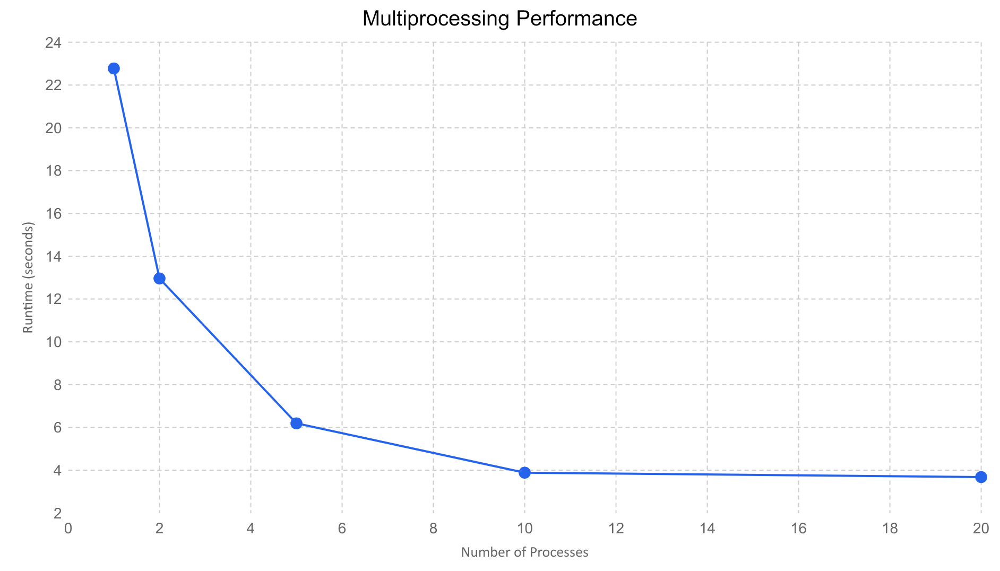

# Lab 11 - Multiprocessing

**Name:** Joshua Simon  
**Course:** CPE2600 - Systems Programming  
**Section:** [Enter section number]

## 1. Program Overview

For this lab, I created a program called `mandelmovie.c` that uses multiprocessing to generate 50 Mandelbrot images at different zoom levels.

The program uses `fork()` to create child processes and `execl()` to run the original `mandel` program. The number of child processes is selected by the user through the command line using `getopt()`.

Each child generates an image, and the parent uses `wait()` to make sure all child processes finish before the program exits.

The 50 images are then combined into a movie using FFmpeg.

## 2. Runtime Results

I tested the program using 1, 2, 5, 10, and 20 child processes. The runtimes were measured using the `time` command in Ubuntu.

| Number of Processes | Runtime (seconds) |
|---|---|
| 1 | 22.774 |
| 2 | 12.960 |
| 5 | 6.191 |
| 10 | 3.884 |
| 20 | 3.680 |

### Runtime Graph



## 3. Discussion of Results

The results show that using more child processes reduced the total time needed to generate the 50 images.

With 1 process, the program took 22.774 seconds. With 20 processes, the runtime decreased to 3.680 seconds, making the program approximately 6.19 times faster.

However, increasing the number of processes did not always provide a large improvement. Going from 10 to 20 processes only reduced the runtime from 3.884 to 3.680 seconds.

This shows that multiprocessing can improve performance, but the benefits become smaller as more processes are added.

## 4. Running the Program

Compile the original Mandelbrot program using:

```bash
make
```

Compile the multiprocessing program using:

```bash
gcc -Wall -g mandelmovie.c -o mandelmovie
```

Generate 50 images using a selected number of processes:

```bash
./mandelmovie -p 5
```

Generate the movie using FFmpeg:

```bash
ffmpeg -i mandel%d.jpg mandel.mpg
```

## 5. Movie

The completed Mandelbrot movie is included in this repository as `mandel.mpg`.
